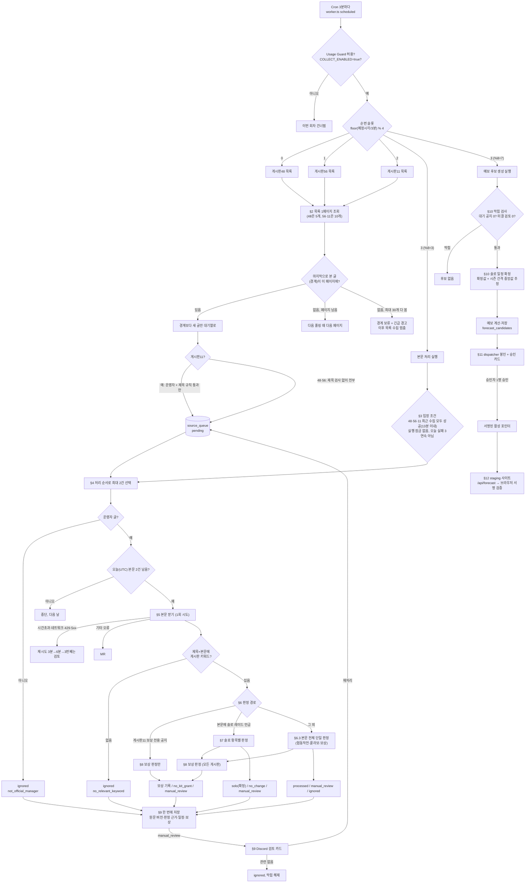

# 예보 workflow 상세 분석 — 게시물 감시부터 일정 확정·사이트 반영까지

- 기준: 브랜치 `next`, 커밋 `8e30e4d`(staging collector `2dc47cb4`와 같은 코드), 읽기 전용 정적 분석.
- 대상 환경: **staging**. 운영(production)은 목록 수집만 하고 본문 판정·예보 후보·실시간 반영은 코드상 꺼져 있습니다(§10).
- 표기: `파일:함수`는 점검할 때 바로 찾아갈 위치입니다. 정규식과 키워드는 코드에 적힌 그대로 옮겼습니다.
- 한계: 실제 배포 상태·DB 값·알림 발송 여부는 이 분석에서 다시 조회하지 않았습니다. 코드에 적힌 동작입니다.

---

## 0. 한눈에 보는 전체 흐름



---

## 1. 언제 감시하는가 — 실행 시각

`forecast-collector/wrangler.toml`, `collection-schedule.ts:rotationBoard`, `worker.ts:runRotation`

1. Cron은 **3분마다**(`*/3 * * * *`) 실행됩니다. 계속 지켜보는 방식이 아니라 정해진 시각에 목록을 한 번씩 읽는 방식입니다.
2. 무엇을 할지는 실행 예정 시각으로 정합니다: `Math.floor(예정시각 / 180_000) % 4`

   | 나머지 | 하는 일 | 주기 |
   |---|---|---|
   | 0 | 게시판48(점검·업데이트) 목록 | 12분마다 |
   | 1 | 게시판56(이벤트·솔로 레이드) 목록 | 12분마다 |
   | 2 | 게시판11(보상·중단·재오픈) 목록 | 12분마다 |
   | 3 | `% 8 = 3`이면 본문 처리, `% 8 = 7`이면 후보 생성 | 각각 24분마다, 12분 엇갈림 |

   예: `48 → 56 → 11 → 본문 처리 → 48 → 56 → 11 → 후보 생성 → …` 순서가 반복됩니다. 기준은 정각이 아니라 Unix 시각이라 매시 같은 분에 시작하지는 않습니다.
3. 같은 회차가 두 번 배달돼도 실행 ID(`rotation-board-48:<예정시각>:v2` 등)를 `INSERT OR IGNORE`로 기록해 한 번만 실행합니다.
4. 실행 전 공통 차단 조건(`worker.ts:scheduled`, `shared/usageGuard.ts`)
   - `COLLECT_ENABLED`가 `"true"`가 아니면 건너뜁니다.
   - Usage Guard 상태가 `disable_staging`, `disable_forecast_production`, `disable_statistics_writes`, `hard_stop` 중 하나면 staging 자동 작업을 멈춥니다.
   - 사용량 관측값이 120분 이상 오래되면 `hard_stop`, 45분 이상이면 `disable_forecast_production`으로 취급합니다(값이 없거나 이상해도 차단 쪽).
   - Guard 검사는 실행 시작, 본문 처리 진입, 공지 1건마다, 저장 직전에 반복됩니다.
5. 게시판11 수집은 DB에 migration 27 이상이 있어야 합니다(`board11-policy.ts:board11InvocationGate`).

## 2. 목록 감시 — 어떤 글을 대기열에 넣는가

`naver.ts:fetchNaverFeedMetadata`, `parseNaverFeedMetadata`, `isValidFeedRow`, `source-queue.ts:pollNaverSource`

### 2.1 요청
- 주소: `https://comm-api.game.naver.com/nng_main/v1/community/lounge/nikke/feed`
- 조건: `boardId=<11|48|56>`, `order=NEW`(최신순), `buffFilteringYN=N`, `offset=<페이지 번호>`
- 한 번에 읽는 개수: 게시판48은 **5개**(staging 설정 `NAVER_BOARD48_PAGE_SIZE="5"`), 56·11은 **10개**
- 제한: 10초 시간초과, 응답 2MB 이하. 네트워크 오류·시간초과·429·5xx면 바로 1번 더 시도합니다.
- **목록 단계에서는 본문을 읽지 않습니다.** 제목·작성 시각·작성자 역할·게시판 번호만 봅니다.

### 2.2 행 검사
- 광고·배너 행(`advertisement`, `ad === true`, `type`이 `advertisement`/`banner`)은 건너뜁니다.
- 정상 글 조건: 글 ID가 숫자 1~20자리, 제목 1~300자, 라운지 `nikke`, 요청한 게시판 번호와 일치.
- 알 수 없는 모양의 행이 하나라도 있으면 그 페이지 전체를 버리고 긴급 경고 `naver_partial_schema_drift`를 냅니다. 이때 대기열에 넣지도, 커서를 넘기지도 않습니다.
- **운영자 판정**: `user.role === "game_manager"` 또는 `user.userRoleCode === "game_manager"`

### 2.3 얼마나 거슬러 보는가 (경계 방식)
- DB에 "마지막으로 처리한 글"(경계)을 저장해 둡니다.
- 한 번 폴링할 때 **1페이지만** 읽고, 최대 **30개**까지 거슬러 봅니다(48은 5개씩 6페이지, 56·11은 10개씩 3페이지).
  - 경계 글을 찾으면 그보다 새 글만 대기열에 넣고 경계를 갱신합니다.
  - 못 찾았고 페이지가 남았으면, 다음 폴링 때 다음 페이지를 읽습니다.
  - 30개를 다 봐도 못 찾으면 **경계 보류**가 됩니다. 긴급 경고 `naver_scan_boundary_missing`을 내고, 이후 그 게시판의 일반 수집을 멈춘 채 복구를 시도합니다.
- 처음 수집할 때(경계 없음)는 **첫 페이지만** 대기열에 넣습니다. 그보다 오래된 글은 자동으로 들어오지 않습니다.
- 날짜 기준 필터는 없습니다. 오직 개수와 경계로만 판단합니다.

### 2.4 경계 보류 자동 복구 (`recoverMovedNaverBoundary`, `readBoundaryRecoveryPages`)
- 경계 글이 다른 게시판으로 옮겨진 경우: 상세 API로 그 글의 게시판이 바뀌었는지 확인되면 최대 10개 범위에서 복구합니다.
- 경계 글이 다시 보이는 경우: 최대 40개 범위에서 순서·운영자·작성 시각을 검증한 뒤 복구합니다.
- 복구에 성공하면 경고 해결, 대기열 추가, 경계 갱신을 한 번에 처리합니다. 실패하면 보류가 유지됩니다.

### 2.5 대기열에 들어가는 조건

| 게시판 | 운영자 글만? | 제목 검사 | 결과 |
|---|---|---|---|
| 48 | 아니요(아무 글이나 들어감) | **없음** | `pending` |
| 56 | 아니요 | **없음** | `pending` |
| 11 | **예** | 아래 규칙 통과해야 함 | `pending` |

게시판11 제목 규칙(`board11-policy.ts:board11TitleRelevant`), 셋 중 하나만 맞으면 됩니다.
```ts
(/솔로\s*레이드/.test(title) && /중단|재\s*오픈|재개|후속\s*처리/.test(title)) ||
/보상\s*(?:지급|안내)/.test(title) ||
(/기념|축하/.test(title) && /보상|선물|지급/.test(title))
```
- 이미 대기열에 있는 글이면 제목·URL·작성 시각만 갱신하고, 상태(`processed`/`ignored`/`manual_review`)는 바꾸지 않습니다.

### 2.6 목록 수집 실패 시
- 일반 오류: 다음 시도까지 3·3·6·12·24·30분 순으로 늘어납니다(`db.ts:nextNaverRetryAt`).
- 3번 연속 실패하고 재시도 시각이 아직 안 됐으면 그 게시판은 `circuit_open`이 되어 요청하지 않습니다.

## 3. 본문 처리 실행에 들어가는 조건

`runtime-ingestion.ts:runRuntimeInvocation`, `runtime-ingestion-db.ts:startIngestion`, `collection-schedule.ts:ROTATION_INGESTION_ADMISSION_SQL`

아래를 **모두** 만족해야 본문 처리를 시작합니다.
1. `ENVIRONMENT === "staging"`이고 `RUNTIME_INGESTION_ENABLED === "true"`
2. 하루 한도 `RUNTIME_NOTICE_DAILY_LIMIT`가 0~20 사이 정수(staging은 2)
3. 실행 중인 다른 작업이 없음(잠금 120초)
4. 오늘 최근 3번의 실행이 모두 실패한 상태가 아님(본문 처리와 후보 생성을 따로 셈)
5. **48·56·11 세 게시판의 가장 최근 수집이 모두 성공**했고, 모두 13분(`780_000`ms) 안에 끝났으며, 그 뒤로 본문 처리를 아직 안 했음

→ 세 게시판 중 하나라도 수집이 실패·보류 중이면 본문 처리를 하지 않습니다.

## 4. 어떤 공지부터 본문을 읽는가

`runtime-ingestion-db.ts:ingestionQueue`

- 대상 상태: `pending`, `processed`, `ignored`
- 제외: `manual_review` 상태, 게시판11의 `ignored`, 사람이 '관련 없음'·직접 입력으로 확정한 글, 다음 확인 시각이 아직 안 된 글
- 우선순위(코드 그대로):
  1. 게시판11 `pending` 중 **처음 본 지 24시간이 넘은** 글
  2. 게시판56 `pending` 중 제목에 `솔로 레이드` 또는 `솔로레이드`가 있는 글
  3. 게시판48 `pending`
  4. 그 밖의 `pending`
  5. 이미 처리한 글(`processed`/`ignored`)의 재확인
- 같은 순위 안에서는 한 번도 확인 안 한 글 → 오래전에 확인한 글 → 최신 글 순입니다.
- 한 번 실행에 최대 **2건**을 고릅니다(`INGESTION_BATCH_LIMIT=2`).
- 재확인은 마지막 확인 후 **24시간이 지나야** 대상이 됩니다. 대기 공지가 있으면 계속 밀리므로, 하루 한 번을 보장하지는 않습니다.

## 5. 본문 받기 — 한도·키워드·오류

`runtime-ingestion-db.ts:reserveNotice`, `notice.ts:fetchNotice`, `parseNoticeDetail`, `naver.ts:parseNaverFeed`

### 5.1 한도
- **하루(UTC 기준, 한국 시각 09:00에 초기화) 전체 2건, 실행 1번에 2건**
- 요청 전에 1건을 예약합니다. 실패해도 예약은 차감됩니다.
- 운영자 글이 아니면 예약하지 않고 바로 `ignored`(`not_official_manager`) 처리합니다.
- 예약에 실패하면 거기서 멈춥니다. 다음 글로 넘어가지 않습니다.

### 5.2 요청과 신원 확인
- 주소: `.../feed/<글ID>`, 10초 시간초과, 2MB 이하, **1번만 시도**, 리다이렉트 거부
- 응답의 글 ID·게시판 번호가 요청과 같아야 하고, `userRoleCode === "game_manager"`여야 합니다.
- 받은 URL이 대기열에 저장된 URL과 다르면 `naver_detail_url_mismatch`
- 본문은 SmartEditor 구조여야 합니다. 아니면 `naver_unstructured_body`

### 5.3 키워드 검사 (`BOARD_KEYWORDS`)
**제목+본문**을 공백 정리한 뒤, 아래 문자열이 **글자 그대로** 들어 있는지 봅니다(띄어쓰기도 정확히 일치해야 함).

| 게시판 | 키워드 |
|---|---|
| 11 | `솔로 레이드`, `솔로레이드`, `보상`, `관리 키트 상자` |
| 56 | `솔로 레이드`, `솔로레이드`, `솔레`, `협동 작전`, `협동작전`, `협작`, `콜라보` |
| 48 | 56의 7개 + `중단`, `연장`, `재개`, `종료`, `일정 변경`, `보상`, `지급`, `관리 키트 상자`, `상자 II`, `상자 Ⅱ` |

- 하나도 없으면 `ignored`(`no_relevant_keyword`). 이 경우에도 본문 한도 1건은 이미 썼습니다.

### 5.4 본문 텍스트 만들기 (`solo-sections.ts:extractNoticeText`)
- `effective`: **취소선(`strike`/`s`/`del` 태그) 글자를 뺀** 본문 → 솔로·보상 판정에 사용
- `evidence`: 취소선 글자를 `~~`로 감싸 남긴 본문 → 카드 근거 표시용
- `legacyText`: 태그만 지운 본문(**취소선 글자도 남음**) → 키워드 검사와 §6.3 단일 판정에 사용
- CSS로 그은 취소선은 인식하지 못합니다(태그 기준).

### 5.5 오류 처리
- 재시도 대상은 `naver_timeout`, `naver_network`, `naver_http_429`, `naver_http_5xx`뿐입니다.
  - 1번째 실패는 3분 뒤, 2번째는 6분 뒤에 다시 시도하고, 3번째 실패하면 `manual_review`로 넘깁니다(연속 실패 횟수 기준).
- 그 밖의 오류(리다이렉트, 형식 이상, 신원 불일치, URL 불일치, 비구조 본문)는 **바로 `manual_review`**입니다.

## 6. 판정 경로 고르기

`notice-processing.ts:processFetchedNotice`, `naver.ts:parseScheduleEvents`

### 6.1 경로 선택 순서
1. **게시판11 보상 전용 공지**(`compensationOnly`):
   제목이 `/보상\s*(?:지급|안내)/`에 맞고, 본문(취소선 제외)에 `/중단|재\s*오픈|재개|일정\s*변경|연장|진행\s*기간/`이 **없으면** 일정 판정을 건너뛰고 보상 판정(§8)만 합니다.
2. **솔로 레이드 판정**(§7): 본문(취소선 제외, **제목은 보지 않음**)에 `1. 솔로 레이드` 같은 번호 항목이 있거나 `/(솔로\s*레이드|솔레)/`가 있으면 이 경로를 탑니다.
3. **단일 판정**(§6.3): 위 두 경로가 아니면 본문 전체를 한 덩어리로 판정합니다.
4. 솔로/단일 판정이 끝나면 **게시판과 상관없이** 보상 판정(§8)도 실행합니다(DB가 있고 migration 27 이상일 때).

### 6.2 결과 고르기 (`noticeEventResult`)
- 보상 판정에 불명확한 항목이 있으면 그것이 우선해 `manual_review`가 됩니다.
- 게시판11 보상 전용(또는 솔로 아님) 공지에 관리 키트가 없으면 `ignored`(`no_kit_grant`)
- 그 외에는 검토 필요 일정이 하나라도 있으면 `manual_review`, 일정이 있으면 `processed`
- 일정이 하나도 없으면 `ignored`: 모든 항목이 '변경 없음'이면 `no_change`, 아니면 `no_schedule_event`

### 6.3 단일 판정(솔로가 아닌 공지)
**분류**(`classifyEvent`, 위에서부터 먼저 맞는 것)
```ts
/(솔로\s*레이드|솔레)/       → 같은 문장에 /(중단|연장|재개|재오픈|종료|일정\s*변경)/ 있으면 schedule_change, 없으면 solo
/(협동\s*작전|협작)/         → cooperation (협동작전)
/콜라보/                     → collaboration (콜라보)
/(관리\s*키트\s*상자|보상\s*지급)/ → reward
그 외                         → 일정 없음
```
**날짜**: 본문 전체에서 **처음 나오는 날짜 범위 1개**를 씁니다(§7.3 규칙과 같음).

**검토로 넘기는 조건**(하나라도 맞으면)
```ts
!item.structured || !item.official ||
/점검\s*완료\s*후/.test(text) ||
((eventType === "solo" || eventType === "schedule_change") && /재오픈/.test(text)) ||
(/(중단|연장|재개|일정\s*변경)/.test(text) && schedule === null)
```
- 사유: 운영자 아님 → `not_official_manager`, 비구조 → `unstructured_body`, 나머지 → `ambiguous_schedule_change`
- **날짜를 못 읽어도 위 조건에 안 걸리면 검토 없이 '날짜 없는 확정'으로 저장될 수 있습니다**(§13-3).

## 7. 솔로 레이드 일정 판정

`solo-judgment.ts:judgeSolo`, `solo-sections.ts:soloSections`, `solo-interruptions.ts`

### 7.1 항목 나누기
- 항목 경계: `/^\d+\.\s/`(번호 줄) 또는 `/^[·─\s]+$/`(구분선)
- 솔로 항목으로 인정하는 줄: `/^\d+\.\s+솔로\s*레이드(?:\s|$)/`
  - `1. 솔로 레이드`는 인정하지만, `1) 솔로 레이드`, `- 솔로 레이드`, `1. 솔레`는 인정하지 않습니다.
- 번호 항목이 없고 본문에 솔로 언급만 있으면, 본문 전체를 한 항목으로 봅니다.

### 7.2 항목별 판정 순서
1. **중단·재오픈 검사가 먼저**(§7.6). 해당하면 아래 일반 판정을 건너뜁니다.
2. **기간 줄 고르기**: 번호 항목이면 아래에 맞는 **첫 줄**을 기간 줄로 씁니다.
   ```regex
   /(?:(?:이벤트\s*)?진행\s*기간|오픈\s*일시)\s*[:：-]/
   ```
   번호 없는 공지는 본문 전체를 씁니다.
3. **변경 표현 검사**(`classificationReason`, 앞에서부터 먼저 맞는 것): 번호 항목이면 항목 전체, 번호 없는 공지면 솔로 언급 문장만 봅니다.
   | 조건 | 사유 |
   |---|---|
   | 운영자 아님 | `not_official_manager` |
   | 비구조 본문 | `unstructured_body` |
   | `/중단/` | `suspension_without_known_season` |
   | `/재오픈\|재개/` | `reopen_without_suspension` |
   | `/연장\|일정\s*변경/`, 또는 번호 없는 공지의 `/종료/` | `schedule_change_in_section` |
4. **날짜 읽기**: 기간 줄에서 `점검 완료 후`를 지우고 초 단위를 버린 뒤(`12:00:00`→`12:00`) 날짜 범위를 읽습니다(§7.3).
5. **'점검 완료 후' 시작 시각 확정**(§7.4)
6. 날짜를 못 읽었는데 앞 사유가 없으면 `ambiguous_schedule_change`
7. **저장된 확정 일정과 비교**(§7.5). 다르면 `schedule_conflict`
8. **결과**: 사유가 있으면 `manual_review`, 저장된 일정과 같으면 `no_change`(새 일정 안 만듦), 그 외에는 `solo`(확정 일정 생성)

### 7.3 날짜 범위 읽기 규칙 (`naver.ts:parseKoreanDateRange`)
- 형식: `[연도.]월.일[일][(요일)][오전|오후][시[:분]] ~ [연도.]월.일[일][(요일)][오전|오후][시[:분]]`
  - 연도 구분자: `.`, `년`, `/`, `-` / 월·일 구분자: `.`, `월`, `/`, `-`
  - 범위 구분자: `~`, `～`, `부터`, `–`, `—` (**일반 하이픈 `-`는 범위로 인정하지 않음**)
  - 끝쪽에도 월·일이 모두 있어야 합니다(`6/18~22`는 읽지 못함).
- 연도가 없으면 **게시 시각의 UTC 연도**를 씁니다. 끝 월이 시작 월보다 작으면 다음 해로 봅니다.
- 시각이 없으면 시작은 **05:00**, 끝은 **04:59**(한국 시각)
- 시만 있고 분이 없으면 `:00`. `오후`는 +12시간, `오전 12`는 0시
- 끝이 시작보다 늦지 않으면 날짜 없음으로 처리합니다.

### 7.4 '점검 완료 후' 시작 시각 (`soloLookup`, `noticeMaintenance`, `maintenanceStart`)
1. 공지 본문에 `점검 일시`가 **없을 때만**, 각 항목에서 `[연도년] 월[월/]일일[(요일)] … 점검 완료 후` 형태의 날짜를 찾습니다.
2. 그 날짜로 DB의 **게시판48 저장 공지**를 검색합니다.
   - 같은 해 1월 1일부터 해당 날짜 다음 날 0시(UTC) 사이에 게시된 글
   - 본문의 공백을 지우고 `:`·`：`를 `-`로 바꾼 뒤, `점검일시-6월11일`(0을 붙인 표기 포함) 문자열이 들어 있는 글
   - 글마다 최신 버전만, 날짜마다 최대 60개
   - 운영자 여부·검토 상태는 이 검색에서 따로 보지 않습니다.
3. 공지 자체에 `점검 일시`가 **있으면 그 공지 안의 값만** 씁니다(형식이 안 맞아도 DB 검색으로 넘어가지 않음).
4. 점검 시각 형식: `점검 일시 : 6월 11일 (목) 00:00:00 ~ 12:00:00` (괄호와 **초까지 양쪽 모두** 있어야 함)
5. 결과
   | 상황 | 결과 |
   |---|---|
   | 맞는 점검 종료 시각 1개 | 시작 시각을 그 종료 시각으로 바꿈 |
   | 하나도 없음 | `maintenance_missing` |
   | 서로 다른 종료 시각 여러 개 | `maintenance_conflict` |
   | 종료가 다음 날 05:00 이후 | `maintenance_crosses_day` |
6. 점검 공지가 **나중에** 처리돼도 앞서 막힌 솔로 공지를 자동으로 다시 판정하지 않습니다. `[재처리]`가 필요합니다.

### 7.5 저장된 일정과 비교 (`knownSolo`, `equalSolo`, `equivalentEnd`)
- 비교 대상: 다른 공지에서 나온 `solo`, **확정**, 검토 불필요, 시작·끝이 있는 일정 중에서
  **시작 게임일(05:00 기준)이 같거나 기간이 겹치는** 것
- '같음' 조건: 대상이 **모두** 시작 게임일이 같고 끝이 같아야 합니다.
  - 끝이 04:59이면 04:59:00~04:59:59를 같은 값으로 봅니다. 다른 시각은 정확히 같아야 합니다.
  - 시작 **시각**이 달라도 게임일이 같으면 '같음'입니다.
- 비교 대상이 없으면 새 일정으로 확정합니다.
- 추정(estimated) 일정은 비교 대상에서 빠집니다.

### 7.6 중단·재오픈 (`solo-interruptions.ts:judgeInterruption`)
- `/재\s*오픈|재개/`가 있으면 재오픈, 없고 `/중단/`이 있으면 중단으로 봅니다. 둘 다 있으면 재오픈이 우선입니다.
- 보스 이름(`솔로 레이드 - ○○`, `랩쳐는 「○○」`)이 보이면 저장된 일정의 제목·본문에도 같은 이름이 있어야 합니다.
- **중단**: `중단` 줄에서 `월/일 시:분` 시각 1개를 찾아, 그 시각에 진행 중이던 시즌 1개를 특정합니다. 성공하면 그 시즌을 '시작~중단 시각' 구간으로 기록하고, 실패하면 `suspension_without_known_season`
- **재오픈**: 항목에서 기간을 읽고, 앞서 중단된 같은 시즌(`시즌 N` 표기가 있으면 일치해야 함) 1개를 찾습니다. 재오픈 시작이 중단 구간 끝보다 늦으면 '재오픈' 구간을 추가하고, 실패하면 `reopen_without_suspension`
- 구간이 여러 개인 시즌은 1구간부터 순서대로 합칩니다(`collapseSoloSegments`). 같은 번호인데 날짜가 다르면 `solo_segment_conflict`, 1구간이 없으면 `solo_initial_segment_missing`

## 8. 보상(관리 키트) 판정

`grants.ts:planGrants`, `parseGrantBlocks`, `claimDeadline`, `grantTarget`

### 8.1 블록과 아이템
- `보상 안내`가 들어간 줄마다 블록을 나눕니다. 각 블록에 `/보상|기념|축하/`와 관리 키트 수량이 있어야 보상으로 봅니다.
- 아이템·수량:
  ```regex
  /관리\s*키트\s*상자\s*(II|Ⅱ)?\s*(?:[*×xX:]|\s)\s*(\d[\d,]*)/g
  ```
  - `관리 키트 상자` → 일반 상자, `관리 키트 상자 II/Ⅱ` → 상자 II
  - `상자 II`만 있거나 소문자 `ii`면 인식하지 않습니다.
  - 한 블록 안의 같은 아이템은 합산합니다. 수량이 양의 정수가 아니면 `grant_quantity_invalid`

### 8.2 지급일
- `지급일 : 6월 23일` 또는 `6월 23일 지급` 형태, 없으면 `오늘 지급`/`오늘 중 지급`은 게시일(한국 날짜)로 봅니다.
- 서로 다른 날짜가 2개 이상이거나 하나도 없으면 `compensation_grant_date_missing`
- 연도가 없으면 게시 연도(한국)를 씁니다. 그 날짜가 **게시일보다 과거**면 `compensation_grant_date_ambiguous`

### 8.3 수령 기한
- `수령 기한 : 월/일 시:분[:초]` 형태만 읽습니다.
- '수령 기한'이라는 말은 있는데 읽지 못하면 `compensation_claim_deadline_ambiguous`
- 수령 기한이 없으면 **지급일 당일에만 받을 수 있는 공급**으로 계산합니다(`claimWindowAssumed=true`).

### 8.4 재안내 연결 (다른 공지가 같은 보상을 다시 알린 경우)
아래를 **모두** 만족할 때만 기존 보상과 같은 것으로 봅니다.
1. 재안내 표현: `/○월 ○일 지급 보상 안내/` 또는 `/이전\s*공지에서\s*약속드린\s*보상/`
2. 지급일이 명시돼 있음
3. 그 날짜의 다른 공지 보상이 정확히 1개
4. 수량이 완전히 같음

- 하나라도 어긋나는데 ±1일 안에 다른 보상이 있거나 재안내 표현이 있으면 `compensation_restatement_ambiguous`(검토)
- 같은 공지가 수정되어 수량이 바뀐 경우: 같은 보상 ID로 새 버전을 추가합니다. 날짜가 사라지면 `grant_same_date_blocks_changed`

### 8.5 저장과 반영
- 보상 ID: `grant:<게시판>:<글ID>:<지급일>:<순번>`. 표 3개 모두 수정·삭제를 막아 두었고, 새 버전만 추가할 수 있습니다.
- 예보에서는 **지급일 05:00에 받을 수 있는 공급**으로 넣습니다. 보유 재고를 자동으로 늘리지는 않습니다.
- 예보 범위 밖 보상의 검토는 `grant_outside_horizon` 자동 제외 대상입니다(§10.3).

## 9. 저장과 사람 검토

`runtime-ingestion-db.ts:ingestionSettlement`, `manual-review.ts`, `forecast-dispatcher/src/discord.ts`, `forecast-interactions/src/manual-interactions.ts`

### 9.1 저장
- 원문 버전, 판정 근거(항목별 질문·근거 문장·기존 일정 비교), 일정, 보상, 대기열 상태, 다음 확인 시각을 **하나의 묶음(batch)**으로 저장합니다.
- 정상 처리된 공지는 24시간 뒤 다시 확인 대상이 됩니다. 수정된 공지는 이 재확인 때 새 버전으로 판정됩니다.

### 9.2 검토 카드
- 대기열이 `manual_review`가 되면 검토 기록이 생기고, 14일 뒤 만료됩니다. 만료돼도 공지는 처리되지 않은 채 남아 예보를 계속 막고, 갱신할 수 있습니다.
- Discord 카드에는 공지 제목·링크, 감지 시각, 항목 최대 3개의 **확인 질문·막힌 이유·근거 문장·기존 일정 비교·권장 조치**가 표시됩니다.
- 버튼(설정된 승인자 1명만, 누르면 확인 단계를 한 번 더 거침)

  | 버튼 | 효과 | 예보 막힘 |
  |---|---|---|
  | **재처리** | 대기열 `pending`, 시도 횟수 0, 세대 번호 +1 → 다음 본문 처리 때 다시 판정 | 다시 판정되어 `processed`/`ignored`가 될 때까지 유지 |
  | **관련 없음** | 대기열 `ignored` | 즉시 해제 |
  | 직접 입력(관리 요청) | 사람이 일정을 입력하고 대기열 `processed` | 해제 |
  | 취소 | 확인 단계만 취소 | 변화 없음 |

## 10. 예보 후보 생성 — 일정이 '확정'되는 곳

`runtime-ingestion.ts:prepareNoticeCandidate`, `candidate.ts:resolveSoloSchedule`, `notice-processing.ts:buildNoticeCandidate`

### 10.1 막힘 검사 (순서대로, 하나라도 걸리면 후보 없음)
1. migration 28·29 있음, 게시판11 스키마 있음
2. 저장된 일정이 1개 이상
3. 검토 기록 없는 옛 검토 일정이 있으면 먼저 검토 카드를 만들고 이번 회차는 멈춤
4. **대기열에 `pending` 공지가 하나라도 있으면 막힘**
5. `manual_review` 공지마다 검토 근거가 있어야 하고, 그 검토가 '관련 없음'·직접 입력·재처리 완료로 해소됐거나 자동 제외(§10.3) 대상이어야 함
6. 확정된 솔로 일정끼리 겹치면(완전히 같은 기간 제외) 오류

### 10.2 솔로 일정 확정 규칙
- **사용하는 일정**: `solo`, 확정, 검토 불필요, 날짜 있음
- **기준 시즌**: 끝(게임일 기준)이 아직 지나지 않은 가장 이른 확정 시즌
  - 그 직전 확정 시즌과의 간격이 **21~35일 정수**가 아니면 `confirmed_solo_cadence_out_of_range`
- **이후 시즌**: 코드에 내장된 공식 시즌 기록 40개(2023-05-11~2026-08-20)에 DB의 더 최근 확정 시작일을 더해 **시작 간격 중앙값**을 구하고, 그 간격만큼 미래 시즌을 '추정(estimated)'으로 만듭니다(기간 길이는 기준 시즌과 같음).
- 확정 시즌이 모두 지났으면 마지막 확정 시작일부터 중앙값 간격으로 추정합니다.
- 예보 범위: 오늘부터 **56일** + 간격 1회분
- 중단·재오픈 시즌은 구간별로 넣습니다. 재오픈 보상일도 구간 기준입니다.
- 결과: **진행 중이거나 다음 시즌은 공지에 확정된 날짜**, 그 뒤는 **추정**입니다.

### 10.3 검토 자동 제외 (`publication-exclusions.ts`)
아래 3가지만 사람 판단 없이 예보 막힘에서 뺍니다. 처음 판단한 결과(제외/불가)는 저장 후 바뀌지 않습니다.

| 규칙 | 조건 |
|---|---|
| `grant_outside_horizon` | 보상 지급일 05:00이 예보 범위 밖 |
| `modeled_past_reopen` | 재오픈 검토인데 기간이 예보 시작 전에 끝났고, 같은 재오픈 구간이 이미 반영됨 |
| `irrelevant_museum` | 박물관/아카이브 제목, 1200자 미만, 상자·중단·재오픈·기간 단어 없음 |

### 10.4 저장
- 같은 내용이면 새로 만들지 않고 재사용합니다. ID는 `supply-<게임일>-v<번호>`이고, 내용 해시로 동일성을 확인합니다.

## 11. 승인·끄기·되돌리기

`forecast-dispatcher/src/admission.ts`, `shared/forecast-publication/store.ts`, `forecast-interactions/src/worker.ts`

1. dispatcher가 후보를 한 번에 1개씩 받아 **봉인**(해시 고정)하고 승인 카드를 보냅니다. 카드 유효시간은 24시간입니다.
2. **승인**(설정된 승인자 1명): Usage Guard와 봉인 해시를 확인한 뒤, 서명된 승인 기록과 **활성 포인터**를 만듭니다.
3. **끄기**: 포인터를 `off`로 바꿉니다(승인 기록은 남음). **되돌리기**: 이전에 승인된 예보를 다시 활성화합니다.
4. 모든 조작은 순번을 1씩 올린 서명 포인터로 기록됩니다. 오래된 카드를 누르면 바로 적용하지 않고, 현재 상태 기준으로 다시 확인합니다.

## 12. 사이트 반영 (이전 설명 정정)

`site-worker/src/forecast.ts`, `src/lib/runtimeForecast.ts`, `src/lib/runtimeForecastConfig.ts`

앞서 "`certifiedForecast.ts`는 빌드에 묶인 예보만 읽는다"고만 말씀드렸는데, 실제 반영 경로는 따로 있었습니다.

1. **staging 사이트 Worker**(`FORECAST_RUNTIME_MODE="enabled"`)가 `GET /api/forecast/version`, `GET /api/forecast`를 제공합니다.
   - DB의 `forecast_runtime_active`(활성 포인터) + 승인 기록 + 봉인된 후보를 한 번에 읽습니다.
   - 해시·후보 ID가 포인터와 모두 일치해야 하고, Usage Guard가 허용해야 합니다. 결과는 Worker에서 **최대 60초** 캐시합니다. IP별 속도 제한이 있습니다.
2. **브라우저**(staging 빌드만, `VITE_FORECAST_RUNTIME=staging`)는 페이지를 열 때, 탭이 다시 보일 때, **5분마다** 확인합니다.
   - 빌드에 넣어 둔 공개키로 서명을 검증하고, 순번이 뒤로 가는 것을 거부합니다(5초 시간초과).
   - 검증에 성공하면 그 예보를 쓰고(`active`), `off`이거나 실패하면 **빌드에 묶인 예보**로 계산합니다.
   - 이미 시작된 계산은 도중에 예보를 바꾸지 않습니다.
3. 따라서 Discord 승인 → 늦어도 약 1분(Worker 캐시) + 다음 브라우저 확인(최대 5분 또는 탭 전환) 안에 staging 사이트에 반영됩니다.
4. **운영 사이트**는 `FORECAST_RUNTIME_MODE="off"`이고 운영 빌드에는 이 기능이 없습니다. 지금은 빌드에 묶인 예보만 씁니다.

## 13. 점검할 만한 지점 (코드에서 확인한 사실)

### 감시 단계
1. **하루 본문 2건(UTC 기준)**: 대기 공지가 하나라도 있으면 예보 후보가 멈춥니다. 공지가 몰리면 며칠씩 지연되고, 실패한 요청도 한도를 씁니다.
2. **게시판48·56은 제목 필터·운영자 필터 없이 대기열에 들어감**: 운영자 아닌 글은 본문을 받지 않아 한도를 쓰지 않습니다. 하지만 운영자의 무관한 글(이벤트·이용 안내 등)은 본문을 받은 뒤에야 걸러지므로, 그만큼 한도를 씁니다.
3. **처음 수집할 때는 첫 페이지만**: 30개 이상 놓치면 경계 보류가 걸리고, 그보다 오래된 글은 자동으로 다시 수집하지 않습니다.
4. **세 게시판 중 하나라도 수집이 실패하면 본문 처리 전체가 멈춥니다.**

### 판정 단계
5. **단일 판정의 '점검 완료 후' 검사**: 협동작전·콜라보 공지는 본문 어디에든 `점검 완료 후`가 있으면 무조건 검토로 넘어갑니다. 지금까지 검토 카드의 주요 원인입니다.
6. **솔로 언급이 있는 공지는 협동작전·콜라보·보상 일정을 따로 만들지 않습니다.** 업데이트 공지 한 건에 솔로·협동작전이 함께 있으면 솔로만 판정합니다(보상은 §8에서 별도로 판정).
7. **단일 판정은 첫 번째 날짜 범위를 씁니다.** 본문 앞쪽의 무관한 기간이 일정으로 잡힐 수 있습니다.
8. **단일 판정은 날짜를 못 읽어도 검토하지 않을 수 있습니다**(날짜 없는 '확정' 일정). 솔로 일정 확정은 날짜 있는 솔로만 쓰므로 솔로 예측에는 영향이 없습니다. 콜라보·협동작전 일정이 예보 계산에 어떻게 쓰이는지는 이번 분석에서 끝까지 추적하지 않았습니다.
9. **단일 판정은 취소선 글자를 지우지 않습니다.** 솔로·보상 판정만 취소선을 제외합니다.
10. **번호 항목 인식이 좁습니다**: `1. 솔로 레이드`만 인정합니다. `1) 솔로 레이드`나 `■ 솔로 레이드` 형식이면 본문 전체를 한 항목으로 보게 되어, 무관한 `중단`·`종료` 단어 때문에 검토로 넘어갈 수 있습니다.
11. **점검 시각 형식이 엄격합니다**: 괄호 요일과 초 단위(`00:00:00`)까지 있어야 인식합니다. 공지에 `점검 일시`가 있으면 DB 대체 검색도 하지 않습니다.
12. **같은 날 시작 시각이 달라도 '변경 없음'**입니다(시작 게임일 기준 비교). 점검 연장으로 오픈이 몇 시간 늦어져도 일정 변경으로 잡지 않습니다.
13. **연도 없는 날짜는 UTC 연도 기준**입니다(보상·중단은 한국 연도). 1월 1일 00:00~08:59 KST에 게시된 글은 전년도로 읽힐 수 있습니다.
14. **범위 구분자 `-`와 `6/18~22` 형식은 인식하지 못합니다.**

### 확정·반영 단계
15. **재처리만으로는 막힘이 풀리지 않습니다.** 다시 판정되어 `processed`/`ignored`가 될 때까지 기다려야 하고, 그 판정도 하루 2건 한도를 씁니다.
16. **점검 공지가 늦게 처리되면 솔로 공지를 자동으로 다시 판정하지 않습니다**(재처리 필요).
17. **기준 시즌 간격이 21~35일이 아니면 후보가 실패합니다**(예: 재오픈·특별 일정으로 간격이 벌어질 때).
